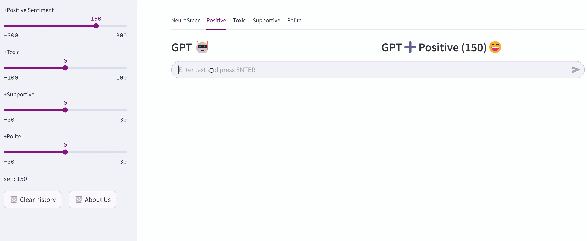

# NeuroSteer: SAE Feature Interventions for Language Model Analysis

Research code for **From Black Box to Controller: Inference-Time Steering of LLM via Feature Amplification**.

NeuroSteer studies how interventions on sparse-autoencoder (SAE) features change language-model continuations. The main workflow compares feature activation statistics between contrasting text classes, selects features by frequency difference, and adds decoded feature directions to the model's residual stream.

The repository focuses on mechanistic interpretability and behavioral intervention experiments: sentiment, toxicity, stance, and politeness; layer-wise analysis; and exploratory combinations of feature directions. These interventions provide evidence about behavior-associated features. They do **not** by themselves identify a complete language-model circuit, prove feature independence, or guarantee reliable control on arbitrary tasks.



## What is available

| Component | Status |
| --- | --- |
| GPT-2-small, layer 6, four-task feature statistics | Recovered from Git history; see `results/demo/demo_v1/` |
| FastAPI + Streamlit demo | Real generation verified on DGX Spark; clear unavailable status when assets fail |
| Frequency-difference filtering and decoded residual interventions | Implemented in `src/denoising.py` and `src/intervention_generation.py` |
| Layer/strength studies and historical generated text | Existing experiment scripts and `results/` outputs retained |
| Gemma-2-2B model loader | Research path retained; four-task GPT-2 demo caches do not apply to Gemma |

Unfinished multimodal prototypes, unsupported Llama/Gemma-1 branches, broken placeholder tests, and scripts targeting absent programs have been removed. No multimodal or universal-task support is claimed.

## Public demo

[Open NeuroSteer](https://neurosteer.keqichen.top/) — runs GPT-2 inference on DGX Spark, with VPS forwarding and a Cloudflare domain. See [public deployment notes](demo/deploy/public/README.md).

## Run the demo

Use Python 3.11 or 3.12 and install a PyTorch build compatible with your hardware. Then, from the repository root:

```bash
python -m venv .venv
source .venv/bin/activate
python -m pip install -r requirements.txt
bash demo/run_backend.sh
```

In a second terminal, activate the same environment and run:

```bash
bash demo/run_fronted.sh
```

Open `http://127.0.0.1:8501`. The API listens at `http://127.0.0.1:8000`; `/health` returns 200 only after GPT-2, its layer-6 SAE and all task directions load successfully. The first model load may download public weights from Hugging Face. The frontend is a text-continuation experiment interface, not a multi-turn instruction-model chat system.

For UI/API-only development, install `demo/requirements.txt` instead of the research requirements. Inference remains unavailable without PyTorch, SAE Lens, TransformerLens and model assets.

## Data, weights, and logs

- `src/data/`: dataset preparation scripts and source notes; full training datasets are not included.
- `results/demo/demo_v1/`: four recovered task-statistics caches, each approximately 395 KB. These are **not** GPT-2 or SAE model checkpoints.
- `results/generated_texts_*.md`: historical generations, including failure cases; these are not freshly reproduced results.
- `src/log.py`: experiment logging utility; experiment runs write `execution.log` under their configured output directory.
- `logs/demo/`: backend/frontend logs when using the local launch scripts.

See [demo directory guide](demo/README.md), [verified DGX Spark deployment](demo/deploy/spark/README.md), and [paper/implementation notes](doc/PAPER_ALIGNMENT.md).

## Research workflow

1. Prepare the relevant sentiment, toxicity, stance or politeness dataset.
2. Collect per-feature activation frequencies and means on contrasting classes.
3. Select feature indices with `src/denoising.py`.
4. Decode selected feature contributions and intervene at the matching residual hook.
5. Compare baseline and intervention generations; evaluate steering alongside PPL, diversity and failure cases.

Scripts in `src/scripts/` are historical experiment configurations. Some retain original machine-specific paths; update dataset, interpreter, output and device settings before running them. They are not a one-command reproduction guarantee. The demo reuses recovered statistics and does not require rerunning dataset preprocessing.

## Validation and interpretation

```bash
python -m pip install httpx
python -m unittest discover -s demo/tests -v
```

API/UI tests are distinct from real model inference and from reproducing paper metrics. Report intervention strengths, layer indices, dataset splits, sampling settings and evaluation models when conducting new experiments. Different backbone sizes or CPU/GPU timing setups do not establish matched-method superiority. Sparse features and their effects may overlap; compositional control remains exploratory.

## Paper

**From Black Box to Controller: Inference-Time Steering of LLM via Feature Amplification**

Keqi Chen, Zekai Sun, Yuhua Wen, Tianyi Tian, Xinyang Huang, Huijun Lian, Yingming Gao, Ya Li.

An arXiv identifier/DOI is not recorded here yet. The paper and this repository should be cited using verified publication metadata when available.
